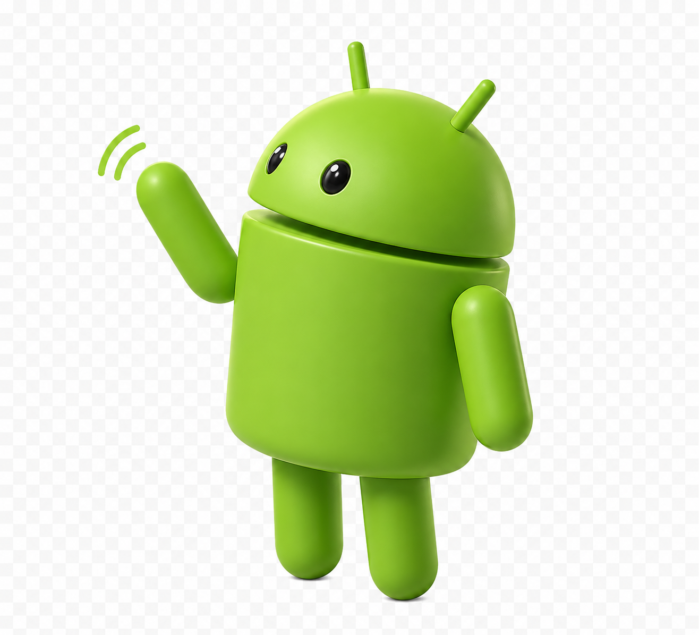

<h1 align="center">Hey 👋, I'm Kunal Raj</h1>

  

  

---

## 👨‍💻 About Me

- 📱 Primarily focused on **Android development**
- 🧩 Interested in building **real-world products from idea to implementation**
- 🏗️ Enjoy working on **architecture, UI, performance, and problem solving**
- 🚀 Currently building and improving personal projects
- 💼 Open to **Android development opportunities, freelance projects, and collaborations**
- 🧠 Focused on building software with a strong emphasis on quality and maintainability
- ⚡ Fun fact: *Books + Music = Perfect Day*

---

## 🚧 Currently Working On

💬 **Bubbles** — A real-time 1-to-1 chat application built to explore scalable Android architecture, authentication, firebase storage, Cloud Firestore, real-time messaging, and offline support.

**🔨 Currently in active development.**

---

## 💻 Building Under Contraris

**Contraris** is my developer identity for publishing and experimenting with Android products on Google Play.

I use it to turn ideas into real products, learn through hands-on development, and continuously improve through user feedback.

📱 **[View Contraris on Google Play](https://play.google.com/store/apps/developer?id=Contraris)**

---

## 🚀 Featured Project

### 🎵 LocalWave — Local Music Player

A modern offline Android music player built for a clean, responsive, and distraction-free listening experience, with persistent playback and dynamic album-based theming.

**Highlights:**

- 🎧 Offline local music playback
- 🎨 Dynamic album-based theming
- ❤️ Favourite songs and library management
- 🔔 Background playback & notification controls
- 🔄 Shuffle and repeat modes
- 💾 Persistent playback state
- 🌗 Light & dark themes
- 📱 Responsive Android UI

**Built with:** `Kotlin` `Jetpack Compose` `Material 3` `Media3` `Android Services` `DataStore` `Coroutines & Flow` `MVVM`

📱 **[Get LocalWave on Google Play](https://play.google.com/store/apps/details?id=kr.android.musicplayer)**

💻 **[Project Preview](https://github.com/divinelydemonic/LocalWave-Music-Player-Android-Preview)**

📌 **Version:** 1.0.1

---

## 📚 Currently Learning

- 🏗️ Advanced Android architecture and scalable application design
- 🧠 System design and software engineering fundamentals
- ⚡ Performance optimization and efficient app development
- 🌐 Backend integration and API-driven applications
- 🔐 Authentication, authorization, and secure data handling
- 🧪 Testing, debugging, and production-quality development
- 🎨 Responsive UI/UX and better product experiences

---

## 🛠️ Core Skills

- **💻 Languages:** Kotlin, Java
- **📱 Android Development:** Android SDK, Jetpack Compose, Material 3, Navigation Compose
- **🏗️ Architecture:** MVVM, Repository Pattern, Clean Architecture, Lifecycle-aware State Management
- **⚡ Concurrency:** Kotlin Coroutines, Flow, StateFlow
- **💉 Dependency Injection:** Hilt, Manual
- **💾 Local Storage:** Room Database, SQLite, DataStore
- **🌐 Networking:** Retrofit, OkHttp, REST API Integration, Kotlin Serialization
- **🔥 Firebase & Authentication:** Firebase Authentication, Cloud Firestore, Firebase Storage, Google Sign-In, Credential Manager
- **🎵 Media Development:** Media3, ExoPlayer, MediaSession, Background Playback
- **🧪 Testing:** JUnit, MockK, Compose UI Testing
- **⚙️ Background Processing:** WorkManager, Android Services, Notifications
- **🧰 Development Tools:** Android Studio, IntelliJ IDEA, Gradle, Git, GitHub, Postman, GitHub Actions                            

---

## 🧠 Technologies & Tools

  

---

## 📊 GitHub Analytics

  

  

---

## 🐍 Contribution Snake

  

---

## 🤝 Let's Connect

  Have an interesting idea, a project in mind, or just want to talk tech? I'd love to hear from you.

  
  
  
  
  

<table style="width:100%; border:0; border-collapse:collapse;">
  <tr>
    <td width="50%" valign="top" style="border:0; padding:64px 24px 16px 0;">
      <h3>💼 Android Development Services</h3>
      
Have an Android app idea? Let's bring it to life.

      

        📱 <a href="https://www.upwork.com/services/product/development-it-a-modern-android-app-using-kotlin-and-jetpack-compose-2092154947218719221?ref=project_share"><b>Android App Development</b></a>
         
        Kotlin · Jetpack Compose
      

      

        🎨 <a href="https://www.upwork.com/services/product/development-it-a-responsive-android-ui-using-kotlin-jetpack-compose-2092937728402043198?ref=project_share"><b>Android UI Development</b></a>
         
        Responsive Android interfaces
      

    </td>
    <td width="50%" valign="top" style="border:0; padding:64px 0 16px 24px;">
      <h3>📬 Get in Touch</h3>
      
Have a project, collaboration, or opportunity in mind?

      

        <b>Primary Email</b>
         
        <a href="mailto:divinelydemonic.dev@gmail.com">divinelydemonic.dev@gmail.com</a>
      

      

        <b>Freelance</b>
         
        <a href="https://www.upwork.com/freelancers/~016b9b06bff44952f6">Find me on Upwork →</a>
      

    </td>
  </tr>
</table>

---

  <i>Turning ideas into products, one build at a time. 🚀</i>

